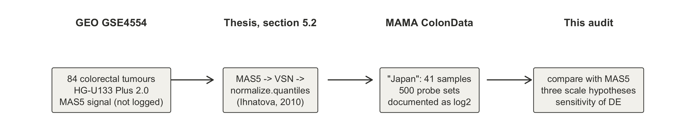
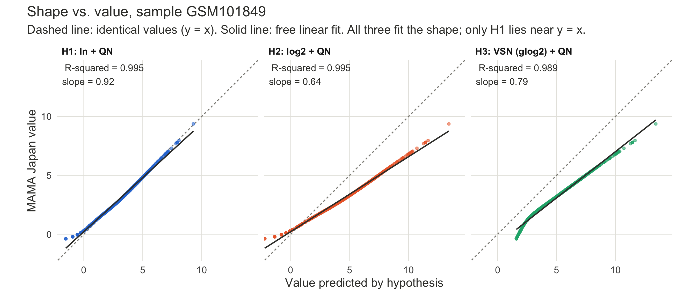
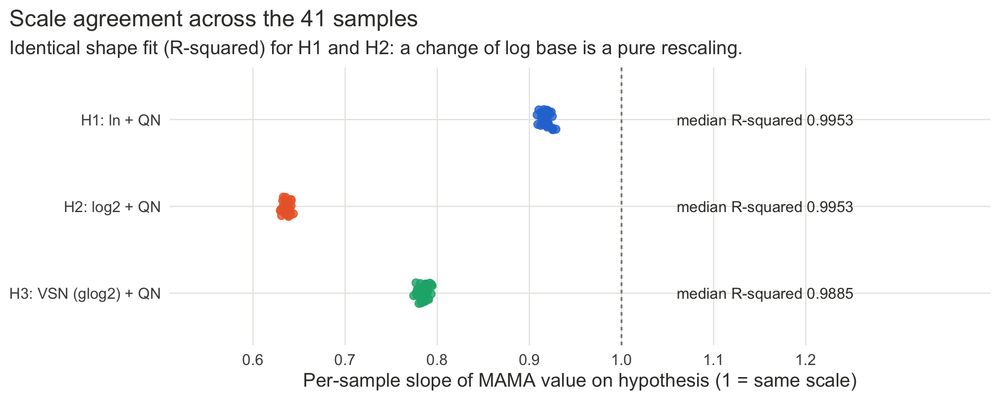
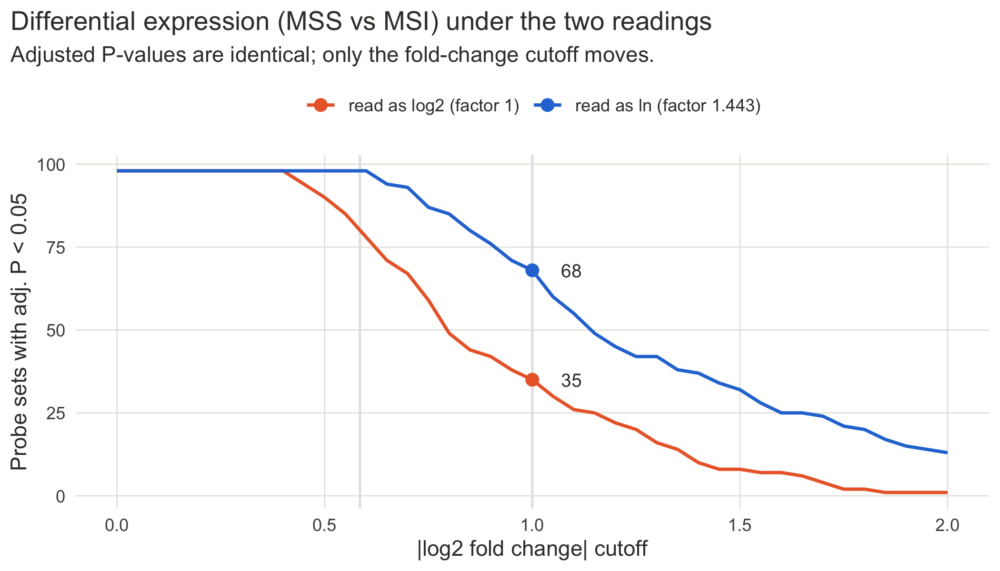

# What scale is the MAMA ColonData "Japan" matrix on?

*A provenance and scale audit of a widely reused example microarray dataset*

## Summary

The "Japan" component of the `ColonData` example in the R package **MAMA** (500 probe sets × 41 colorectal tumours) is documented as normalized and log2-transformed. I traced it back to its public source, GEO series **GSE4554**. There it is stored as unlogged MAS5 signal. I then tested which transformation reproduces the MAMA values.

- **Provenance is certain.** Within every sample, the MAMA values are a strict monotone function of the GSE4554 MAS5 signal (the single exception is one cell whose MAS5 value is 0). The MSI/MSS labels agree with GEO for 41 of 41 samples. The package author's thesis documents the pipeline as MAS5 → VSN → quantile normalization.
- **The numerical scale is not certain.** None of the three candidate transformations reproduces the values exactly: natural log, log2, or the documented VSN (glog2), each followed by quantile normalization. Without any extra rescaling, the values are closest to a **natural-log** scale (slope 0.92). Under the documented VSN pipeline they would need an unexplained rescaling by about 0.78.
- **Consequence:** P-values and rankings from a differential-expression analysis do not depend on this question. Fold-change cutoffs do. At |log2FC| ≥ 1, 35 probe sets pass if the data are read as log2, and 68 pass if they are read as ln.



## 1. Motivation

I was reproducing a web-based (ExpressAnalyst) microarray workflow in R with limma. Along the way I checked whether the input values were on the scale the software assumes. Three features of the data did not fit a typical log2 microarray matrix:

| Observation | Typical log2 MAS5 / RMA | This matrix |
|---|---|---|
| Range | about 2 to 14 | −0.54 to 9.36 |
| Median | about 5 to 7 | 3.18 |
| Negative values | rare | 581 (of 20,500) |

Back-transforming the maximum gives e^9.36 ≈ 11,600 (a plausible MAS5 signal) but 2^9.36 ≈ 660 (implausibly low). This raised the question of whether the matrix is on a natural-log scale, even though it is labelled log2.

## 2. Tracing the source

1. **GEO.** The sample identifiers (`GSM101784`–`GSM101864`) belong to **GSE4554** (Watanabe et al., 2006), which comprises 84 primary colorectal cancers on the Affymetrix HG-U133 Plus 2.0 array (GPL570). The GEO `VALUE` column is described as *"MAS5-calculated Signal intensity"* and is not log-transformed.
2. **MAMA.** The matrix matches the `Japan` element of `ColonData` in MAMA 2.2.1 (CRAN archive). The package documentation describes the data as *"normalized, log2-transformed"*, with a random selection of 500 genes.
3. **Thesis.** The package author's master's thesis (Ihnatová, 2010, Masaryk University; section 5.2) states that two other studies were re-processed from CEL files with RMA. For GSE4554 only MAS5 profiles were available, and these were *"further normalized by VSN and quantile normalization (normalize.quantiles from preprocessCore)"* (translated from Slovak).

Checks against GEO (`results/provenance_summary.csv`):

| Check | Result |
|---|---|
| MSI/MSS labels in MAMA vs GEO descriptions | 41 / 41 agree (16 MSI, 25 MSS) |
| Per-sample Spearman correlation with MAS5 | 1 in 40 samples; 0.9998 in GSM101805, where one probe with MAS5 = 0 is out of order (zero apparently treated as missing) |
| Spread of MAMA values among equal MAS5 values within a sample | 0 (a deterministic per-sample function) |
| Negative values whose MAS5 detection call is *Absent* | 581 / 581 (MAS5 signal median 0.3, max 5.8) |

The negative values are therefore expected. They are low-signal, undetected probes whose transformed value falls below zero, not errors.

## 3. Three scale hypotheses

Each candidate was computed on all 84 GSE4554 arrays, as in the original processing, and then compared with the MAMA values of the 41 samples (`R/03_scale_tests.R`):

- **H1**: ln(MAS5) → quantile normalization
- **H2**: log2(MAS5) → quantile normalization
- **H3**: VSN, `vsn::vsn2`, glog2 output → quantile normalization (the documented pipeline)

**A key point: shape is not value.** The R² of a free linear fit y = a·x + b measures only whether two variables have the same shape. Two variables agree in value only if a ≈ 1, b ≈ 0 and the absolute differences are small. For example, x = 1, 2, 3 and y = 10, 20, 30 fit perfectly (R² = 1) but differ ten-fold.



| Hypothesis | Median R² (shape) | Per-sample slope (scale) | Median intercept | Median abs. difference | Slope of group differences |
|---|---|---|---|---|---|
| H1 ln + QN | 0.9953 | 0.908–0.929 | 0.21 | **0.17** | **0.93** |
| H2 log2 + QN | 0.9953 | 0.630–0.644 | 0.21 | 1.67 | 0.64 |
| H3 VSN + QN | 0.9885 | 0.774–0.794 | −0.83 | 1.83 | 0.77 |



Level and spread, computed without any fitting (`results/scale_level_spread.csv`):

| | Median | SD |
|---|---|---|
| MAMA Japan (observed) | 3.19 | 1.76 |
| H1 ln + QN | 3.36 | 1.92 |
| H2 log2 + QN | 4.85 | 2.76 |
| H3 VSN + QN | 4.98 | 2.23 |

Back-transforming the observed median gives e^3.19 = 24.2, close to the MAS5 median of 26.5. Using 2^3.19 gives 9.1.

### Why the log base cannot be proven from the data alone

H1 and H2 have *identical* R², and this is exact rather than coincidental. Changing the log base multiplies the data by a constant (log2 x = ln x / ln 2), and quantile normalization commutes with such scaling: QN(c·x) = c·QN(x). Any argument for "ln rather than log2" therefore rests on the assumption that **no extra rescaling** was applied after the log transform. Under that assumption, H1 is clearly closest. Without it, H1 and H2 are indistinguishable.

### The documented pipeline does not reproduce the values either

H3 is the pipeline the author describes. With current software (vsn 3.80.0, preprocessCore), it fits the shape slightly *worse* than a plain log (R² 0.9885 vs 0.9953), and it would need a rescaling by about 0.78. A plausible explanation is that the 2010 analysis used an older vsn version or different settings, but I could not test this. The documentation's "log2" is consistent with VSN's glog2 output. So the documentation may well be correct in intent, while the stored values remain unexplained.

## 4. Does it matter for differential expression?

limma, MSS vs MSI, 41 samples (`R/04_sensitivity.R`):

- After rescaling the whole matrix by 1/ln 2, adjusted P-values differ by at most 1.3 × 10⁻¹⁴. Significance and ranking are **scale-invariant**.
- Only fold-change cutoffs depend on the scale. A cutoff of |log2FC| ≥ c corresponds to c·ln 2 on a natural-log scale.

| Cutoff on \|log2FC\| (adj. P < 0.05) | Read as log2 | Read as ln |
|---|---|---|
| 0 | 98 | 98 |
| 0.585 (1.5-fold) | 80 | 98 |
| 1 (2-fold) | 35 | 68 |



A web tool that assumes log2 input would label these differences as "log2FC". If the true scale is closer to ln, fold changes are understated by up to a factor of 1.44. Running an extra quantile normalization on the already-normalized matrix, as such tools do by default, changes little: the correlation between the two sets of log fold changes is 0.998.

## 5. Conclusions

| | Status |
|---|---|
| Source (GSE4554 → MAMA `Japan`) and MSI/MSS labels | Confirmed |
| Pipeline (MAS5 → VSN → quantile normalization) | Documented by the author; not reproduced numerically |
| Numerical scale | Unresolved. Closest to ln if no extra rescaling was applied; the documented glog2 needs an unexplained factor of about 0.78 |
| Significance and rankings | Unaffected |
| Fold-change magnitudes and cutoffs | Uncertain by a factor between about 1 and 1.44 |

**Practical recommendation:** when using this dataset, follow the documented scale (log2/glog2) for the primary analysis, state the uncertainty, and report fold-change-based gene counts under both readings.

**Open question:** the vsn version and settings used in 2010, and whether any additional scaling was applied, could only be confirmed by the package author.

## Reproducing this audit

From the repository root (R ≥ 4.3, with Bioconductor packages `GEOquery`, `vsn`, `preprocessCore`, `limma`, plus `ggplot2`):

```sh
Rscript scale_audit/R/run_all.R
```

| Script | Purpose |
|---|---|
| `R/01_get_data.R` | Download MAMA 2.2.1 (CRAN archive) and the GSE4554 series matrix |
| `R/02_provenance.R` | Labels, rank agreement, negative values vs detection calls |
| `R/03_scale_tests.R` | The three hypotheses: fits, level/spread, group differences |
| `R/04_sensitivity.R` | limma: scale invariance and fold-change cutoffs |
| `R/05_figures.R` | Figures 1–4 |

All inputs are downloaded from public sources at run time; no data files are stored in this repository. Tables are written to `results/` and figures to `figures/`.

## References

- Huber, W., von Heydebreck, A., Sültmann, H., Poustka, A., & Vingron, M. (2002). Variance stabilization applied to microarray data calibration and to the quantification of differential expression. *Bioinformatics, 18*(Suppl. 1), S96–S104. https://doi.org/10.1093/bioinformatics/18.suppl_1.S96
- Ihnatová, I. (2010). *Implementácia metód pre meta-analýzu dát z microarray experimentov* [Implementation of methods for meta-analysis of data from microarray experiments] (Master's thesis, Masaryk University). https://is.muni.cz/th/j5fmj/
- Ihnatová, I. (2013). *MAMA: Meta-Analysis of MicroArray* (R package version 2.2.1). https://cran.r-project.org/src/contrib/Archive/MAMA/
- Smyth, G. K. (2004). Linear models and empirical Bayes methods for assessing differential expression in microarray experiments. *Statistical Applications in Genetics and Molecular Biology, 3*(1), Article 3. https://doi.org/10.2202/1544-6115.1027
- Watanabe, T., Kobunai, T., Toda, E., et al. (2006). Distal colorectal cancers with microsatellite instability (MSI) display distinct gene expression profiles that are different from proximal MSI cancers. *Cancer Research, 66*(20), 9804–9808. https://doi.org/10.1158/0008-5472.CAN-06-1163

## Use of AI tools

I identified the scale issue myself during independent verification; AI tools were used to assist in tracing the GEO metadata, locating the MAMA package source, verifying the original author's thesis, and drafting code and text, and all results were run and checked by me.
